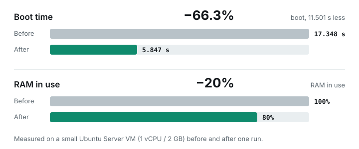

# Ubuntu Server Optimizer

Interactive, reusable cleanup script based on the steps tested on a small Ubuntu Server VM under Proxmox/KVM. It is intended for headless Ubuntu Server machines, including small 1-vCPU / 2-GB RAM VMs. It checks Ubuntu but does not claim every Ubuntu release or server role has been tested.



## One-click install (Ubuntu Server)

Run on the Ubuntu server:

```bash
curl -fsSLO https://raw.githubusercontent.com/GodYtteria/ubuntu-vm-optimizer/release/0.0.2/optimize-ubuntu-server.sh
chmod +x optimize-ubuntu-server.sh
sudo ./optimize-ubuntu-server.sh --dry-run
sudo ./optimize-ubuntu-server.sh --expand-lvm
```

The first run (`--dry-run`) only prints the plan. The second run applies it and asks before each removal. `--expand-lvm` adds the optional LVM question; leave it off to skip it.

## What it removes or changes

Nothing is removed without a prompt, except the settings below.

Changed without asking:
- Default boot target set to `multi-user.target` (desktop packages stay installed).
- `apport.service` and `motd-news.timer` disabled, if present.
- APT package cache cleared.
- DNS resolvers set through `/etc/systemd/resolved.conf.d/90-uvo-dns.conf`: AdGuard first, Cloudflare next, Google as fallback, with opportunistic DNS over TLS. Skipped when `systemd-resolved` is not running. The file is only rewritten when its content differs, and an existing file is saved as `90-uvo-dns.conf.bak` first. AdGuard DNS blocks ad and tracker domains on purpose; if you want no filtering, use the non-filtering AdGuard addresses `94.140.14.140` and `94.140.14.141` instead of `94.140.14.14` and `94.140.15.15` in the script (and in the global check). An older `dns.conf` with exactly the same content (from earlier manual runs) is removed only after the new file is written and verified. After the restart an uncached lookup of `example.com` must work and `resolvectl dns` must list `94.140.14.14` on its Global line (exact address, not a prefix); if it fails, the old file is restored (or the new one removed) and the script exits with an error; `--dns-only` cannot be combined with `--no-dns`. Per-link DNS (for example Tailscale's `100.100.100.100`), `/etc/resolv.conf` and netplan are not touched. Skip with `--no-dns`, or run only this step with `--dns-only`.

Asked before each action (answer `y` to run):
- `apt-get upgrade` after `apt-get update` and a simulated upgrade plan (phased updates stay phased; skip with `--no-upgrade`, include them with `--include-phased`).
- `apt autoremove --purge` of unused packages (the plan is shown first).
- Purge of optional packages if installed: `modemmanager`, `packagekit`, `open-iscsi`, `multipath-tools`.
- Removal of all Snap apps and `snapd` (skip with `--no-snap`).
- Root LVM expansion into existing free VG space (off unless `--expand-lvm` is given).

Never touched: SSH, Tailscale, UFW, core networking, cloud-init. Docker is not installed. CPU and RAM are not changed.

Flags: `--dry-run`, `--no-snap`, `--no-upgrade`, `--include-phased`, `--no-optional`, `--expand-lvm`, `--no-lvm`, `--no-dns`, `--dns-only`, `-y` (skips only the first prompt; removals still ask).

## Features

- Sets `multi-user.target` as default (does not uninstall desktop packages).
- Disables `apport.service` and `motd-news.timer` if present.
- Runs `apt update`, shows a simulated upgrade plan, and asks before `apt upgrade` (phased updates stay phased unless `--include-phased`).
- Cleans APT cache and simulates `apt autoremove --purge` before asking.
- Offers removal of `modemmanager`, `packagekit`, `open-iscsi`, and `multipath-tools`.
- Offers removal of Snap and all installed Snap applications.
- Can offer to extend the root LVM logical volume if the root is on LVM and the VG already has free space. It does not resize the virtual disk, partition, or physical volume.
- Sets DNS to AdGuard, then Cloudflare, with Google as fallback, and checks that lookups still work.
- Reports RAM, disk, failed units, enabled services, boot time, and top 20 slow units.
- Logs to `/var/log/ubuntu-server-optimizer.log`.

## Options

```text
--dry-run       Print plans without making changes
-y, --yes       Skip the initial confirmation only; removals and LVM expansion still require approval
--no-snap       Do not offer Snap removal
--no-upgrade    Do not offer package upgrades
--include-phased Include phased updates (explicit opt-in)
--no-optional   Do not offer optional package removal
--expand-lvm    Offer root LVM expansion if free VG space exists
--no-lvm        Do not offer LVM expansion
--no-dns        Do not set DNS resolvers
--dns-only      Run only the DNS step
-h, --help      Show help
```

## Tests

`bash test-dns.sh` runs the DNS step against a temporary directory with a fake restart command. It checks the first write, no write on a second run, the backup, and the rollback after a failed lookup.

## Safety

- Create a Proxmox snapshot or backup before production changes.
- Do not remove `modemmanager` if using cellular modem hardware.
- Do not remove `open-iscsi` if using iSCSI storage.
- Do not remove `multipath-tools` if using multipath storage.
- Do not remove Snap if required applications/services use Snap.
- Review every APT removal list. `apt autoremove` may remove Ubuntu metapackages (such as `ubuntu-server`) if dependencies are no longer considered required.
- Cloud-init units are deliberately left alone. They can be important on cloud images and VM templates even if cloud-init currently reports disabled.
- SSH, Tailscale, UFW, core networking are never disabled. The DNS step leaves Tailscale DNS alone.
- This does not install Docker, tune application/database configuration, change VM CPU/RAM allocation, resize the virtual disk/partition, or guarantee a specific performance gain.
- The script is interactive by design; it is not intended for blind unattended deployment.

## License

MIT. Copyright (c) GodYtteria. See [LICENSE](LICENSE).
